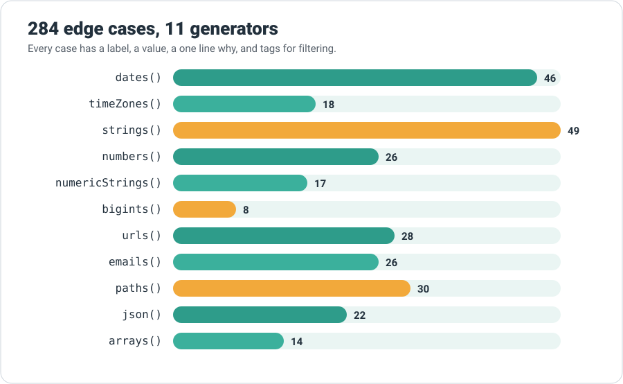

<p align="right"><a href="README.md">English</a> | <strong>Português (Brasil)</strong></p>

<p align="center">
  <picture>
    <source media="(prefers-color-scheme: dark)" srcset="assets/banner-dark.svg">
    
  </picture>
</p>

<h1 align="center">edgegoat: entradas de casos extremos para testes em JavaScript, fusos horários, horário de verão, unicode e números</h1>

<p align="center"><strong>As entradas que quebram código, prontas para os seus testes.</strong></p>

<p align="center">
  <a href="https://www.npmjs.com/package/edgegoat"></a>
  <a href="https://bundlephobia.com/package/edgegoat"></a>
  <a href="https://github.com/kwy404/edgegoat/actions/workflows/ci.yml"></a>
  <a href="LICENSE"></a>
  <a href="https://www.typescriptlang.org/"></a>
</p>

Precisa **testar fuso horário em JavaScript**, **testar horário de verão no Jest** ou no Vitest, ou procura **strings unicode para teste** e **casos extremos de JavaScript** como `-0`, `NaN` e `2^53 + 1`? O edgegoat é uma biblioteca curada e documentada com <!-- total -->284<!-- /total --> entradas que sabidamente quebram código: transições reais de horário de verão calculadas para cada fuso, Ano Novo em Pacific/Kiritimati, datas antes de 1970 com frações de segundo, pares substitutos cortados ao meio, o i com ponto do turco, caminhos do Windows, JSON profundo e arrays esparsos. Cada caso vem com um rótulo e uma explicação de uma linha sobre **por que** ele quebra código, e encaixa direto no `test.each` do Vitest, Jest, node:test ou Mocha. Zero dependências, ESM e CommonJS, tipos TypeScript incluídos.

```ts
import { test, expect } from 'vitest';
import { dates, withTimeZone } from 'edgegoat';

test.each(dates({ tags: ['dst'] }))('$label', ({ value, zone }) => {
  withTimeZone(zone, () => expect(addDays(value, 1).getHours()).toBe(value.getHours()));
});
```

<!-- grid:start -->
<table>
<tr>
<td width="33%" valign="top"><br><strong>Datas</strong> <code>46 casos</code><br><sub>Horário de verão (lacunas e sobreposições), Ano Novo em 7 fusos, 29 de fevereiro, antes de 1970, 2038, ano 10000</sub></td>
<td width="33%" valign="top"><br><strong>Fusos horários</strong> <code>18 casos</code><br><sub>Fusos IANA escolhidos: +05:45, +14:00, -11:00, horário de verão de 30 minutos e à meia-noite</sub></td>
<td width="33%" valign="top"><br><strong>Strings</strong> <code>49 casos</code><br><sub>Emoji, pares substitutos, NFC vs NFD, bidi, espaços invisíveis, i turco, quebras de linha</sub></td>
</tr>
<tr>
<td width="33%" valign="top"><br><strong>Números</strong> <code>51 casos</code><br><sub>-0, NaN, Infinity, limites de inteiros seguros, 0.1 + 0.2, 1e21, strings numéricas e BigInt</sub></td>
<td width="33%" valign="top"><br><strong>URLs e emails</strong> <code>54 casos</code><br><sub>Surpresas do parser WHATWG, formatos de SSRF e open redirect, limites da RFC 5321</sub></td>
<td width="33%" valign="top"><br><strong>Caminhos</strong> <code>30 casos</code><br><sub>Windows vs POSIX, UNC, nomes reservados, travessia com .., nomes em NFD</sub></td>
</tr>
<tr>
<td width="33%" valign="top"><br><strong>JSON</strong> <code>22 casos</code><br><sub>10000 níveis, chaves duplicadas, 2^53 + 1, __proto__, BOM</sub></td>
<td width="33%" valign="top"><br><strong>Arrays</strong> <code>14 casos</code><br><sub>Buracos, length 2^32 - 1, NaN, sort padrão, grande demais para spread</sub></td>
<td width="33%" valign="top"><br><strong>Helpers</strong> <code>4 funções</code><br><sub>withTimeZone, withFrozenTime, check, assertNoThrow</sub></td>
</tr>
</table>
<!-- grid:end -->

<p align="center">
  
</p>

## Sumário

- [Como instalo o edgegoat?](#como-instalo-o-edgegoat)
- [Como uso com Vitest, Jest, node:test ou Mocha?](#como-uso-com-vitest-jest-nodetest-ou-mocha)
- [Quais casos extremos estão incluídos?](#quais-casos-extremos-estão-incluídos)
- [Como funcionam os helpers?](#como-funcionam-os-helpers)
- [Bugs que essas entradas encontraram](#bugs-que-essas-entradas-encontraram)
- [Perguntas frequentes](#perguntas-frequentes)
- [Como o edgegoat se compara ao fast-check e à big-list-of-naughty-strings?](#como-o-edgegoat-se-compara-ao-fast-check-e-à-big-list-of-naughty-strings)
- [Onde estão os guias?](#onde-estão-os-guias)
- [Como contribuir?](#como-contribuir)
- [Licença](#licença)

## Como instalo o edgegoat?

```sh
npm install --save-dev edgegoat
```

Funciona no Node.js 18 ou mais recente e em navegadores modernos (o `withTimeZone` precisa do Node.js). Tem builds ESM e CommonJS com declarações de tipos, nenhuma dependência em tempo de execução e suporte a tree shaking: tudo junto fica em torno de 19 kB minificado com gzip, um único gerador fica entre 2 e 4,5 kB.

## Como uso com Vitest, Jest, node:test ou Mocha?

Cada gerador devolve um array de objetos `{ label, value, why, tags }`. Os casos de data específicos de um fuso também trazem `zone`.

```js
// Jest ou Vitest
test.each(numbers({ tags: ['sign'] }))('$label mantém o sinal', ({ value }) => {
  expect(formatNumber(value).startsWith('-')).toBe(value < 0);
});

// node:test ou Mocha: um laço simples
for (const { label, value } of paths({ tags: ['traversal'] })) {
  test(label, () => assert.throws(() => safeJoin('/srv/app', value)));
}

// Sem test runner
const failures = check((s) => truncate(s, 10), strings(), (out) => out.isWellFormed());
```

Exemplos executáveis estão em [`examples/`](examples), incluindo dois bugs no estilo do mundo real que o edgegoat pega: um [bug de fuso horário no Ano Novo](examples/real-world/format-date.ts), espelhando github/relative-time-element#384, e um [truncate que corta emoji](examples/real-world/truncate.ts).

## Quais casos extremos estão incluídos?

<p align="center">
  
</p>

- `dates()`: lacunas e sobreposições de horário de verão calculadas com `Intl` (Nova York, São Paulo em 2018, Londres, Lord Howe), Ano Novo onde o ano local difere do UTC (Kathmandu +05:45, Kiritimati +14, Pago Pago -11), epoch, antes de 1970 com frações de segundo, 2038, anos 0, 9999 e 10000, data inválida, 29 de fevereiro, fim de mês e semanas ISO.
- `timeZones()`: 18 fusos IANA com deslocamentos ou regras incomuns.
- `strings()`: espaços invisíveis, emoji, pares substitutos, NFC vs NFD, texto bidirecional, armadilhas de maiúsculas e minúsculas, quebras de linha, texto com cara de injeção, dígitos unicode, hangul e tailandês.
- `numbers()`, `numericStrings()` e `bigints()`: `-0`, `NaN`, infinitos, limites de inteiros seguros, valores entre -1 e 0, `0.1 + 0.2`, `1e21`, strings em que `Number` e `parseInt` discordam, limites de int64.
- `urls()`, `emails()`, `paths()`, `json()` e `arrays()`: normalizações do parser WHATWG, endereços válidos que validadores rejeitam, Windows vs POSIX, travessia com `..`, JSON com 10000 níveis, buracos em arrays e mais.

A tabela completa, caso a caso, está no [README em inglês](README.md#full-catalog) e no [catálogo pesquisável](https://kwy404.github.io/edgegoat/#catalog).

```ts
dates({ tags: ['dst'] });                         // só horário de verão
dates({ zone: 'America/Sao_Paulo' });             // qualquer fuso IANA
strings({ tags: ['emoji'], exclude: ['zwj'] });   // filtrar e excluir por tags
```

## Como funcionam os helpers?

- `withTimeZone(zone, fn)`: executa `fn` com `process.env.TZ` igual a `zone` e restaura o fuso anterior, mesmo se `fn` lançar erro ou devolver uma promise rejeitada. Confere se o runtime aplicou o fuso. Só funciona no Node.js; em navegadores lança um erro claro.
- `withFrozenTime(date, fn)`: congela `Date.now()` e `new Date()` durante `fn`, sem fake timers. Pode ser aninhado com `withTimeZone`.
- `check(fn, cases, predicate?)`: roda `fn` em cada caso e devolve as falhas, com rótulo e motivo.
- `assertNoThrow(fn, cases)`: lança um único erro que lista todos os casos em que `fn` lançou exceção.

## Bugs que essas entradas encontraram

Bugs reais deste tipo, corrigidos nos projetos originais pelo autor do edgegoat ([kwy404](https://github.com/kwy404), mais de 120 correções aceitas em projetos do Google, Microsoft, GitHub, Vue, JetBrains, Mozilla e outros):

- [github/relative-time-element#384](https://github.com/github/relative-time-element/pull/384): a verificação de "ano atual" usava UTC em vez do fuso de exibição.
- [mozilla/pdf.js#22017](https://github.com/mozilla/pdf.js/pull/22017): `util.printf` perdia o sinal de números negativos maiores que -1.
- [google/budoux#1411](https://github.com/google/budoux/pull/1411): a segmentação partia pares substitutos.
- [microsoft/vscode-js-debug#2423](https://github.com/microsoft/vscode-js-debug/pull/2423): o truncamento no estilo `trimEnd` partia pares substitutos.
- [salesforce/tough-cookie#644](https://github.com/salesforce/tough-cookie/pull/644): um max-age infinito precisa significar "nunca expira".
- [vuejs/core#15618](https://github.com/vuejs/core/pull/15618): uma correção no build de compatibilidade do Vue 3.

## Perguntas frequentes

### Como testar fuso horário em JavaScript?

Rode as mesmas asserções em vários fusos e use instantes em que a data local e a UTC discordam. Para a execução inteira, `TZ=Asia/Kathmandu npx vitest run`; por teste, `withTimeZone(zone, fn)`. Use `dates({ tags: ['year-boundary'] })` e `timeZones()` como entradas.

### Como testar horário de verão no Jest?

Use instantes reais de transição com `test.each(dates({ tags: ['dst'] }))`, rode cada um no seu `zone` e verifique valores de relógio local, não diferenças em milissegundos.

### Por que -0 é diferente de 0?

Números de ponto flutuante têm um bit de sinal até para o zero. `-0 === 0` é verdadeiro, mas `Object.is(-0, 0)` é falso, `1 / -0` é `-Infinity` e `Intl.NumberFormat` imprime `"-0"`.

### Os horários de transição do horário de verão são fixos no código?

Não. São calculados em tempo de execução com `Intl.DateTimeFormat`, então seguem a base de fusos horários do seu runtime. A suíte de testes confere que cada caso é uma transição real.

## Como o edgegoat se compara ao fast-check e à big-list-of-naughty-strings?

Eles se complementam. O [fast-check](https://github.com/dubzzz/fast-check) faz testes baseados em propriedades com entradas aleatórias e encolhe as falhas. A [big-list-of-naughty-strings](https://github.com/minimaxir/big-list-of-naughty-strings) é uma lista grande de strings para fuzzing. O edgegoat é um conjunto menor e curado de entradas que já quebraram código real, de vários tipos, cada uma explicada e com tags.

## Onde estão os guias?

O site fica em **[kwy404.github.io/edgegoat](https://kwy404.github.io/edgegoat/)** (em inglês):

- [How to test time zones in JavaScript](https://kwy404.github.io/edgegoat/test-timezones-javascript.html)
- [How to test daylight saving time in Jest](https://kwy404.github.io/edgegoat/test-daylight-saving-time-jest.html)
- [Unicode test strings for JavaScript](https://kwy404.github.io/edgegoat/unicode-test-strings.html)
- [JavaScript number edge cases to test](https://kwy404.github.io/edgegoat/javascript-number-edge-cases.html)
- [Testing dates before 1970 in JavaScript](https://kwy404.github.io/edgegoat/test-dates-before-1970.html)
- [Negative zero in JavaScript](https://kwy404.github.io/edgegoat/javascript-negative-zero.html)
- [How to mock Date in JavaScript tests](https://kwy404.github.io/edgegoat/mock-date-javascript.html)
- [Property based testing and curated edge cases](https://kwy404.github.io/edgegoat/property-based-testing-edge-cases.html)

## Como contribuir?

Novos casos são bem-vindos quando já quebraram código real. Todo caso precisa de um `why` e, de preferência, de um link para um bug real. Veja o [CONTRIBUTING.md](CONTRIBUTING.md).

## Licença

[MIT](LICENSE) © 2026 Alexandre Kohler.
